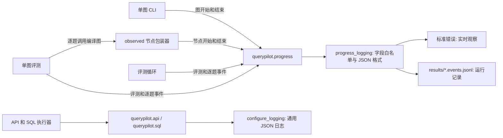
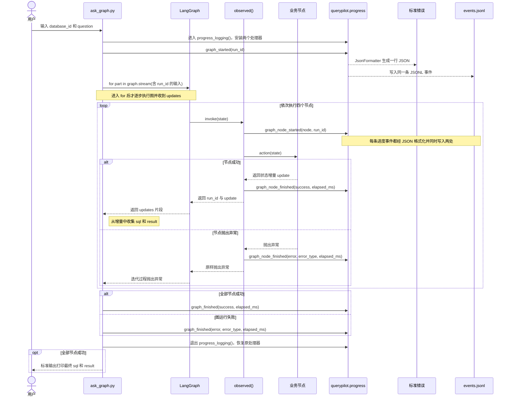

# QueryPilot 运行日志技术设计（当前实现）

## 范围与目标

当前日志覆盖三个入口：`scripts/ask_graph.py` 的单条线性 LangGraph 查询、`scripts/run_eval.py` 的 direct-prompt 评测循环，以及 `scripts/run_graph_eval.py` 的逐题单图评测。direct-prompt 评测不调用单图；单图评测逐题调用同一个编译图。目标是实时显示运行阶段、失败位置和耗时，并保存可关联的本地 JSONL 事件。事件接口见 [observability-interface.md](observability-interface.md)。

本阶段没有 checkpoint、断点续跑、前端 SSE、分布式追踪或多图自动埋点。日志事件也不代表模型推理结果的正确性。

## 数据流和职责



- `src/querypilot/graph/single.py` 的 `observed()` 包装四个业务节点，在实际调用前后计时；捕获异常时只记类型和耗时，然后原样抛出。它是当前节点日志的来源。
- `scripts/ask_graph.py` 调用 `graph.stream(stream_mode="updates", version="v2")`，逐片收集 `sql`、`result` 组成最终答案，并在外围记录图级开始、成功或失败。`updates` 片段本身不承担节点耗时和失败埋点；练习用的投影事件不会重复写入正式日志。
- `src/querypilot/evals/baseline.py` 在评测循环内写逐题开始、完成、计数和 ETA；`scripts/run_eval.py` 对向外传播的异常写 `eval_aborted`。
- `src/querypilot/evals/graph.py` 对每道题调用单图，并将单题图 ID、批次 ID 和题号传入图；单题异常记为 `error` 后继续下一题。其 CLI 用独立的结果文件名，避免与 direct-prompt 基线混淆。
- `src/querypilot/logging.py` 的 `progress_logging()` 为一次 CLI 运行独占创建文件，并给 `querypilot.progress` 装终端及文件处理器；退出上下文时恢复原处理器。`JsonFormatter` 生成单行 JSON。

## 单条图调用的日志时序

以下以 `scripts/ask_graph.py` 处理一次问题为例。四个节点按 `load_schema` → `generate_sql` → `validate_sql` → `execute_sql` 顺序运行；图中的节点循环代表对每个节点重复同一套包装与日志操作。



`graph_node_finished` 来自节点包装器，**不是**把 `updates` 片段直接打印成日志。`updates` 可能含 Schema、SQL 或结果数据，只用于 CLI 组装最终答案；进度格式器的字段白名单不接收这些业务内容。执行节点成功时完成事件还带 `row_count`。若节点失败，后续节点不再运行；异常继续传到 CLI，CLI 记录图级失败后退出，标准输出不会打印不完整的答案。图中省略了独立的 `querypilot.sql` 审计日志，它可能包含 SQL，访问边界与进度日志不同。

## 关联、输出与生命周期

CLI 在运行开始时生成 `run_id`。单图把它传入图输入，节点包装器从状态读取；direct-prompt 评测把它传给 `run_eval()`。单图评测用批次 `run_id` 关联评测事件，再为每题设置 `graph_run_id`，把批次 ID 作为节点事件的 `parent_run_id`。同一题还带有 `question_id` 和 `case_index`。这些 ID **不是** LangGraph checkpoint/thread ID，也不提供恢复能力。单独调用图而未提供 `run_id` 时，首个节点会生成一个 ID；当前线性节点沿状态继续传递。调用方应显式传入 ID。

进度事件同时写到标准错误与 `results/*.events.jsonl`，最终答案或汇总写到标准输出。事件文件用独占模式创建，已存在会报错；`results/` 中运行产物由 Git 忽略。评测结果与事件文件共享文件名前缀；单图文件为 `graph__<run_id>.events.jsonl`。文件是本地运行记录，当前没有轮转、保留期或集中收集。

正常单条图运行有图级和节点级完成事件。节点失败时 `graph_node_finished(status=error)` 先记录，异常继续传播，再由单条查询 CLI 记 `graph_finished(status=error)`。单图评测使用 `eval_case_started` / `eval_case_finished` 包住各题的节点事件。评测逐题捕获的模型/SQL 错误记为该题 `error` 并继续下一题；评测外层未处理异常记 `eval_aborted`。前置校验失败可能发生在事件上下文建立前；强制终止也可能没有结束事件。JSONL 中已有的行仍可用于观察进度，但不等于可恢复的评测状态。

## 数据边界与安全

进度事件只投影运行元数据：运行 ID、数据库 ID、题号、节点名、状态、耗时、计数、行数、异常类型。进度字段白名单不会输出自然语言问题、Schema、SQL、结果行、模型地址或凭据。错误只输出异常类名，不输出异常消息。`JsonFormatter` **不会自动净化任意事件文本**；调用方必须使用固定事件名，并确保传入的允许字段不含敏感数据。

进度流与 SQL 审计流需要区别：`querypilot.sql` 的 `sql_guard`、`sql_executed` 等事件目前可包含原始 SQL。API 的 `configure_logging()` 将它们写到通用日志处理器。部署时应按 SQL 审计日志的敏感度管理访问、保留和导出；不能把“进度日志不含 SQL”理解成所有日志都不含 SQL。评测原始结果 JSON 也可能包含 SQL 或错误详情。

## 多图适用性评估

| 设计点 | 当前可复用部分 | 扩展前必须处理的问题 |
| --- | --- | --- |
| 事件格式 | JSONL、`run_id`、`component`、状态与耗时字段可沿用 | 需要事件版本和明确的字段契约；子图需 `graph_path`、`span_id`、`parent_span_id` 等关联字段 |
| 节点埋点 | `observed()` 可包装新增节点 | 新增子图不会自动被包装；应抽出公共节点包装器，并定义重试、多次执行和异常事件语义 |
| 运行关联 | CLI 显式传入 `run_id` 适合单次调用 | 并行节点在未传入 ID 时可能各自产生 ID；长线程需区分每次调用的 `run_id` 与持久化 `thread_id` |
| 日志落地 | 单进程、单任务本地 CLI 可用 | `progress_logging()` 临时改写全局 logger handlers，并发或嵌套运行会互相覆盖；服务化前需改成固定 handler 加上下文关联、队列或集中收集 |
| 运维 | 可看到本地开始、完成、失败事件 | 缺少跨进程聚合、保留/轮转、背压策略、追踪采样及指标汇总 |

因此当前实现适合本地顺序运行的单图与评测，**不能直接作为并发多图服务的完整日志方案**。进入多图阶段时，先定义运行/线程/子图/节点的身份和生命周期，再消除全局 handler 改写；保留进度白名单和 SQL 审计隔离。完成该改造后，才能以同一事件流可靠统计不同子图的错误率、耗时分布和恢复效果。现阶段没有这些实测指标。

## 本地操作与验证

无需调用模型的评测管线自检：

```powershell
uv run python scripts/run_eval.py --provider fixture --cases evals/bird_smoke.json
```

命令结束后标准输出包含 `output_file` 与 `event_file`。运行时可在另一个 PowerShell 窗口跟踪文件：

```powershell
Get-Content -LiteralPath "results/<本次文件名>.events.jsonl" -Wait
```

真实模型评测使用相同日志机制，但 fixture 自检不能代替模型基线结果。自动化验证覆盖单图的成功/失败节点事件、CLI 流式答案收集和评测进度中的业务内容排除规则。
